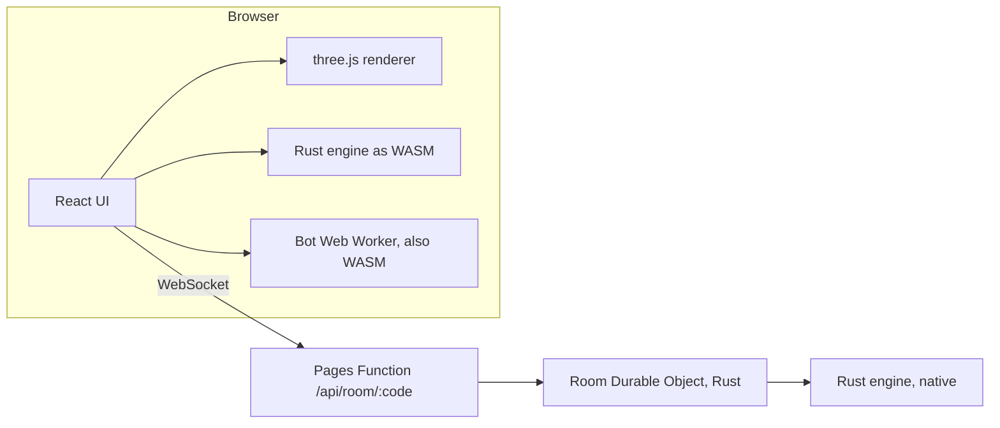

<div align="center">

# cubes

### A territory game of light and corners.

Your light only grows by its corners. Claim the board, one glowing shard at a time.

**[Play it at playcubes.pages.dev →](https://playcubes.pages.dev)** · [☕ Buy me a coffee](https://buymeacoffee.com/winnerkarthik)

`rust` · `webassembly` · `cloudflare-durable-objects` · `workers-rs` · `three.js` · `react` · `bun` · `multiplayer` · `browser-game`

</div>

---

Two to four players take turns laying shards on a shared lattice. A new shard
has to kiss your existing light at a corner, and it may never touch your own
light along a face. You can lean on your opponents all you like. When nobody
can move, whoever holds the most of the board wins.

That one rule turns out to be bottomless, so we kept going.

## What you get

- **Make a link, send it, play.** No accounts, no installs, no ads. Friends
  join from the link; empty seats can be filled with bots; anyone else
  watches.
- **2D and 3D.** *Plane* on a flat board, *Stack* in 3D with gravity (you
  can't stack on yourself, so you climb your rivals and crown their towers),
  and *Orbit*, a free-floating cube where light spreads in every direction.
- **Fog of war.** You see two cells past your own light. Everything else is
  memory. Place into something you couldn't see and it misfires.
- **Arena surges.** Glowing nodes give charge; spend it to **Spark** a single
  cell, **Leap** a gap, **Shatter** an enemy cell, or **Scan** through the fog.
- **More ways to play.** Duel, Pure (no surges), Storm (the edge of the board
  collapses every few rounds), Torus (the board wraps), Teams with shared
  light, and four board shapes.
- **Bots that think.** Ember, Flare and Nova, written in Rust and running in
  a Web Worker in your browser, or inside the room server online.
- **Two looks.** *Night*: luminous glass cubes, bloom, drifting haze.
  *Paper*: the same game, inked in a sketchbook.
- **Learn it in three minutes.** [First light](https://playcubes.pages.dev/learn)
  is an interactive tutorial on real boards, with hand-written notes that
  point at exactly what you did wrong.
- **A daily board.** [/daily](https://playcubes.pages.dev/daily) deals the same
  seeded board to everyone each day (UTC) against Flare, with the mode rotating
  through the week. One counted try, no undo, and a Wordle-style emoji grid
  to brag with.
- **Replays.** After any game, local or online, scrub back through every move.
  Positions are rebuilt from the seed and the move log by the Rust engine, so
  they are exact; online, the room hands the finished match to every player.
- **A record that's yours.** Wins and losses against each bot, best score and
  streaks, kept in your browser and nowhere else.
- **Balanced with data, not vibes.** Bots played thousands of games against
  each other to size the boards and to work out that the second player in a
  two-player game deserves two charge in hand. The numbers are in
  [`docs/BALANCE.md`](docs/BALANCE.md).

## How to play, in thirty seconds

1. Your first shard must touch your **Core** (the glowing beacon) at a corner.
2. Every later shard must touch your light at a corner, never along a face.
3. You can't move? You go dark. Everyone dark? Count the light.
4. One point per cell, plus five if you placed your whole kit.

The full rules, with diagrams, live at [/rules](https://playcubes.pages.dev/rules)
and in [`docs/DESIGN.md`](docs/DESIGN.md).

## How it is put together

```
crates/
  engine/   Rust. The whole game: lattices, kits, a precomputed table of every
            possible placement indexed by cell, the link rule, surges, storm,
            gravity, fog-of-war memory and redacted views, scoring, bots.
            No platform dependencies.
  wasm/     wasm-bindgen bindings. The browser runs the exact same engine.
  rooms/    workers-rs Durable Object. One actor per room, hibernating
            WebSockets, authoritative rules, bots, turn clocks. Room logic is a
            pure state machine, so it is tested natively with `cargo test`.
  sim/      Self-play simulator for tuning bots and balancing presets.
web/
  src/engine   Typed wrapper over the WASM engine, plus a bot Web Worker.
  src/game     Match drivers (local and online) and placement maths.
  src/render3d The Night renderer (react-three-fiber, bloom, instancing).
  src/render2d The Paper renderer (SVG, a home-made ink stroke generator).
  src/audio    Fully procedural sound (Web Audio, no files).
  src/tutorial First light: scripted positions on the real engine.
  src/net      Room client: reconnects, seat tokens, typed protocol.
  functions/   One Pages Function: /api/room/:code -> the room Durable Object.
```



**Why Rust everywhere it counts.** The rules run in three places: the
browser (hints, local games, bots), the server (the referee) and the
simulator (balance). Writing them once in Rust means they can't disagree.
The move table and the bots are hot loops, which is where Rust earns its
keep.

**Why Durable Objects.** One room is one tiny actor with its own memory and
storage, living close to the players and asleep when nobody's talking. It's
the actor model without running a server, and it costs nothing at this scale.

**Fog without trust.** The server never sends you cells you can't see. Your
browser computes hints from what *you* believe the board looks like, which is
also how the bots play under fog.

## Running it yourself

You need Rust (with `wasm32-unknown-unknown`), [`wasm-pack`](https://github.com/wasm-bindgen/wasm-pack),
[`worker-build`](https://crates.io/crates/worker-build) and [Bun](https://bun.sh).

```sh
cargo test --workspace --release      # engine + rooms
cd web
bun install
bun run wasm                          # build the engine for the browser
bun run dev                           # http://localhost:5173

# online rooms, locally
cd ../crates/rooms && npx wrangler dev # Vite proxies /api to :8787
```

## Deploying

Merges don't deploy themselves. Shipping is one command from a machine
logged in to Cloudflare through wrangler's OAuth (no API token to mint or
rotate; if the login has lapsed, the script opens the browser for it):

```sh
scripts/deploy.sh            # rooms Worker, then the site, then a live check
scripts/deploy.sh --site     # only the site, when no Rust changed
scripts/deploy.sh --smoke    # also play a real online game against production
```

It deploys the rooms Worker (`playcubes-rooms`) first, then the Pages site
(`playcubes`, served at playcubes.pages.dev), whose one Pages Function binds
the Worker's Durable Object by script name so the game and its rooms share
an origin. It refuses to ship uncommitted changes, tags the Pages deployment
with the commit, and fails loudly if any main page stops answering 200.

## Docs

- [`docs/DESIGN.md`](docs/DESIGN.md): the rules, every variant, the
  architecture and the data contract between Rust and TypeScript.
- [`docs/BALANCE.md`](docs/BALANCE.md): how the bots were tuned and why the
  boards are the sizes they are.

## Credit where it is due

Fast move generation borrows the idea of precomputing every placement and
indexing it by cell from the open-source engines of this genre, especially
Pentobi by Markus Enzenberger. The code here is our own.

## Keeping it free

cubes has no ads, no accounts and no plans to grow either. If it earned a
spot in your lunch break, you can
[buy me a coffee](https://buymeacoffee.com/winnerkarthik). It funds the late
nights spent arguing with Nova about corners.

## License

MIT. Do what you like with it.
