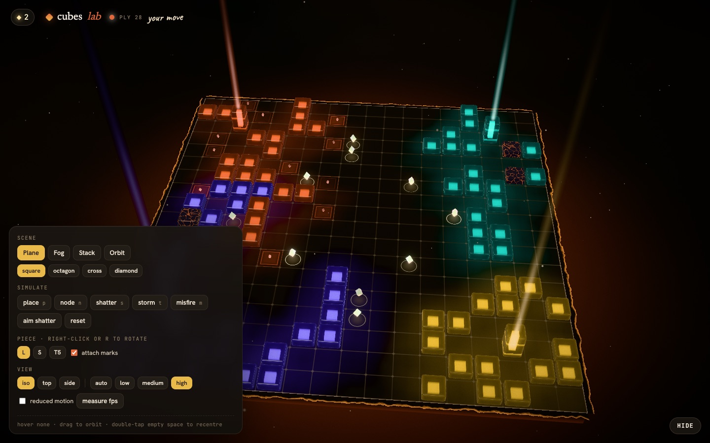
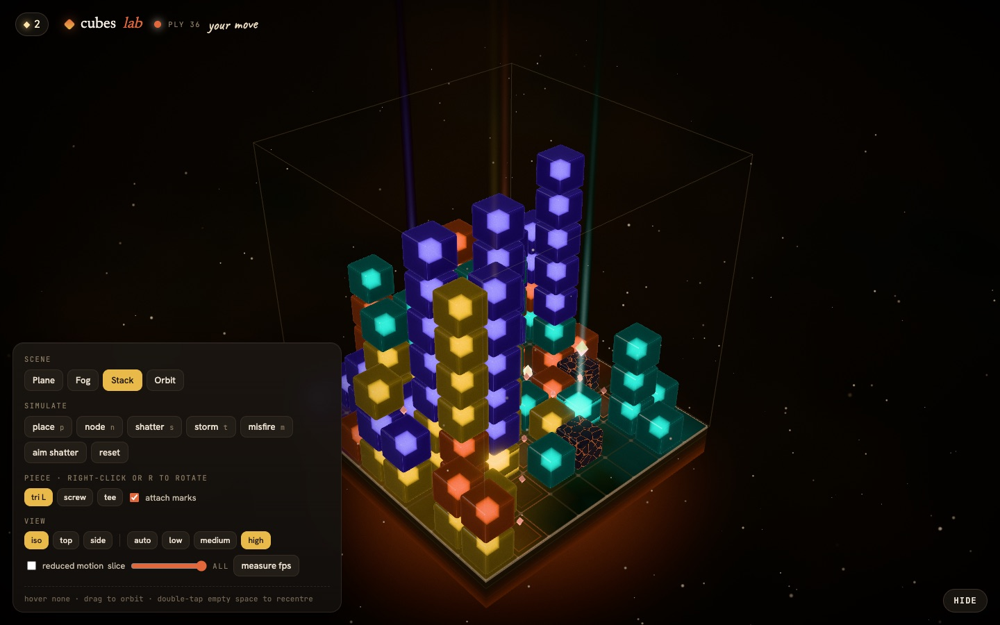
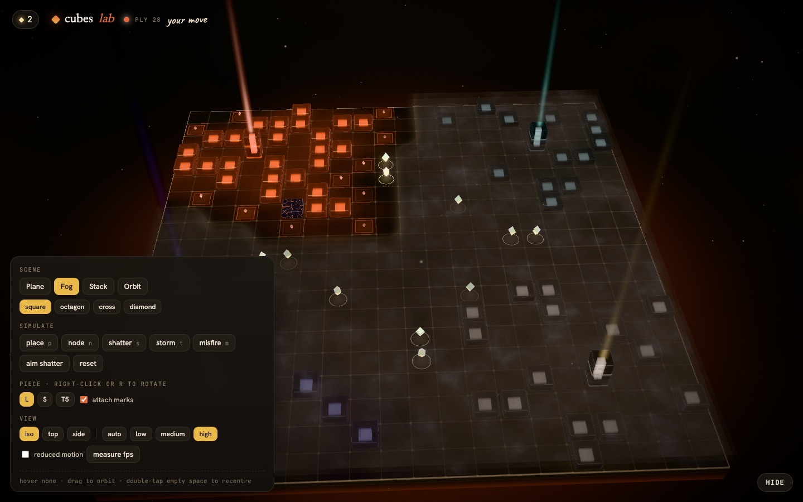
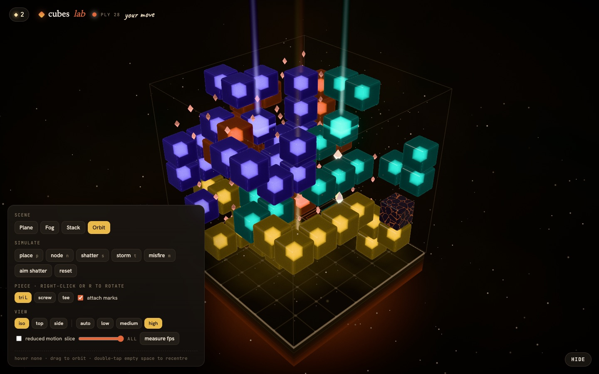
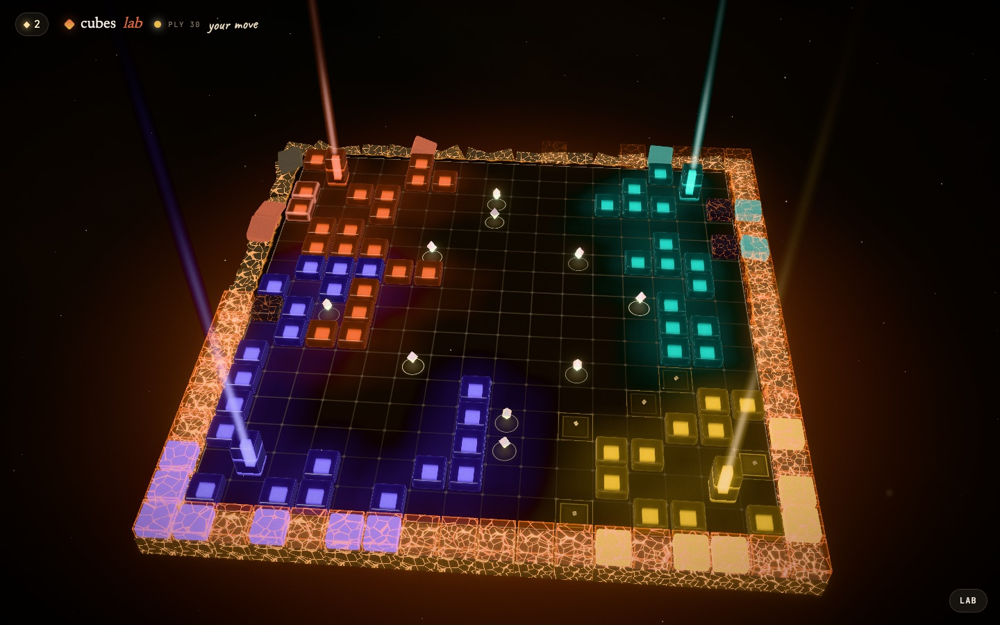
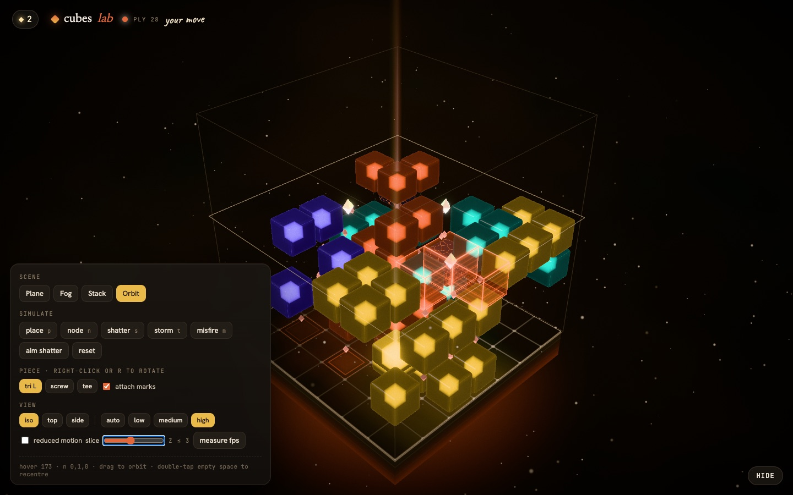

# render3d · the Night board

The in-game renderer for **cubes**: a luminous, jewel-like board on warm
near-black. One component draws every mode, 2D boards as extruded glass tiles
on a tilted slab and 3D lattices (gravity stacks, free-floating orbit) as
glass cubes over a floating island.

```tsx
import { BoardScene } from "@/render3d";

<BoardScene
  view={view}                      // engine View (see src/engine/types.ts)
  ghost={{ cells, seat, valid }}   // or null
  marks={{ attach, targets, lastPlaced, misfire }}
  selectedSeat={seat}
  onHover={(t) => …}               // { cell, normal? } | null
  onSelect={(t) => …}              // { cell, button, shift }
  quality="high"                   // omit to auto-detect and auto-downgrade
  reducedMotion={false}            // defaults to prefers-reduced-motion
  layerCut={null}                  // 3D slice: hide z > layerCut
  cameraPreset="iso"               // "iso" | "top" | "side"
/>
```

| Plane (2D, storm, scars) | Stack (8×8×8 gravity) |
|---|---|
|  |  |
| **Fog (stale memory, haze)** | **Orbit (7×7×7)** |
|  |  |
| **Storm takes a ring** | **Slice view + ghost** |
|  |  |

Try it at `/lab` (route exported from `routes.ts`) or standalone at
`web/lab.html` (`bunx vite`, then open `/lab.html?scene=plane|fog|stack|orbit`).

## Hover and select

- **2D:** the board cell under the pointer. Void cells are never targeted.
- **3D:** voxel-painter. Pointing at a cube face targets the empty cell across
  that face; pointing at the floor targets the empty floor cell. `normal` is
  the board-space step (z up) from the face to the target. With `layerCut` set
  in a free-floating game, the pick plane moves up to the cut layer.
- A press only becomes `onSelect` when it moved under 8 px and lasted under
  600 ms, and never during a multi-touch gesture, so orbiting and pinching
  never place pieces. Right-click arrives as `button: 2`. Double-click or
  double-tap on empty space recentres the camera.

## How it is built

```
BoardScene ── Canvas (dpr per tier, no MSAA on the canvas, flat)
  └ SceneRoot
     ├ CameraRig    drei CameraControls, exact box-fit presets, idle drift
     ├ Backdrop     warm dome + drifting dust (Points)
     ├ Island       floor shader, per-column slab sides, underglow
     ├ Pieces       one instanced draw for cubes + scars, one for core monoliths, beams
     ├ Gems         node crystals + attach diamonds (one instanced draw)
     ├ Cage         3D bounding cage, slice frame, orbit lattice points
     ├ Overlays     shatter-target brackets, misfire glitch
     ├ Fog          stacked noise sheets sampling a visibility texture
     ├ Ghost        holographic preview, plumb lines and footprints in 3D
     ├ Fx           pooled GPU effects (see fxEngine.ts)
     ├ Picker       invisible plane + instanced boxes for raycasts
     └ Post         Bloom (mipmap, threshold 1.0) → Neutral tone map → vignette → grain
```

Pure modules, all unit tested:

| File | What it does |
|---|---|
| `coords.ts` | cell index ↔ world space. Board x → +X, y → +Z, z → +Y; floor top at Y = 0. |
| `hover.ts` | raw pick (plane or face) → hover target, including layer cut and normal snapping. |
| `diff.ts` | previous View + next View → animation events (place, reveal, node, shatter, storm, misfire, remove), using `view.events` for intent the cell diff cannot see. |
| `camera.ts` | preset poses and the exact distance that fits the board's bounding box in the frustum. |
| `quality.ts` | device signals → `low` / `medium` / `high`, plus per-tier settings. |
| `fixtures.ts` | fabricated Views and event simulations for the lab and tests. |

### Why it is fast

- **No scene lights.** Every surface is a small custom shader with baked key
  light, fresnel and fake reflections, so cost does not grow with lights.
- **Few draws.** All pieces share one `InstancedMesh`; buffers are rewritten
  only when the View changes.
- **Animation on the GPU.** Each instance carries a birth time; drop-in,
  squash, flash, sparks, shards, rings and debris integrate in the vertex
  shader. Idle frames do no per-instance CPU work. Only node motes run on the
  CPU, because they chase the camera to the HUD.
- **Parallax glass for free.** The glowing core inside each cube is a
  ray-box intersection in the fragment shader, not extra geometry or
  transmission.
- **Selective bloom by value.** Only colours pushed above 1.0 bloom: cores,
  rims, sparks and beams.
- **Tiers.** `low` caps dpr at 1.25, uses 4 bloom levels and cuts particles;
  `high` adds 4× MSAA, 8 bloom levels, more floor blur taps and fog sheets.
  Without an explicit `quality`, the scene steps down a tier whenever it
  holds under 38 fps for 2.5 s.

### Reduced motion

No camera drift, no drop or squash, no particles, shards or shake. State
changes still flash softly so they stay noticeable.
